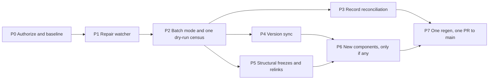

# Upstream backlog plan

**Snapshot:** 2026-11-15, `main` @ `9b4d9b98` (v9.5.0). **Status:** approved by the founder on 2026-11-15; rulings recorded in [CAMPAIGN.md](CAMPAIGN.md). Read-only investigation: nothing was changed to produce it.

The question this plan answers: how can Gaia Skill Tree resolve its upstream backlog with the smallest appropriate combination of canonical synchronization, reconciliation and curation workflows, while preserving governance and avoiding unnecessary agent work?

## The short answer

Most of the visible backlog is stale records, and most of the real work was blocked by one defect and two founder holds.

- 71 of the 72 open child intakes describe skills that are already in the registry. They were admitted by the October L4 review (commit `90c1610f`, 2026-11-03). They need record reconciliation, not curation.
- The Upstream Watcher has written nothing since 2026-10-29: 19 failed runs in a row. Today it stops on the AgentDB source lock, not on the count mismatch that #2278 describes.
- Every tracked upstream repository except `mattpocock/skills` has moved since the 2026-11-02 sync. That is deterministic version sync, with no discovery needed.
- Two families were on founder hold (GBrain, Addy). They cover 71 of the 72 children and two of the nine drifted repositories. The 2026-11-15 rulings lift both for records and version-only sync.
- Gaia Dynamic is not justified. No new candidate outside the held families is known today.

**Path:** repair the watcher, switch it to weekly batch mode before its first write, take one dry-run report as the single census, then run three small parallel lanes (record reconciliation, version sync through the existing approval workflow, structural freezes and relinks) on one integration branch. Curate new components only if the report shows any.

## A. Verified landscape

| Figure | Value |
|---|---|
| Open upstream records | 81 (6 umbrellas, 3 bootstraps, 72 children) |
| Children whose skill is already in the registry | 71 |
| Watcher runs failed in a row since 2026-10-30 | 19 (runs 97 to 115) |
| Named records behind upstream | 15, across 9 repositories |
| Open upstream sync PRs | 0 |

### Release umbrellas (6 open)

| Issue | Suite | Umbrella target | Registry | Latest upstream tag | State |
|---|---|---|---|---|---|
| #2229 | mattpocock/skills | v1.3.2 | v1.3.2 | v1.3.2 | Already synced; record stale |
| #2020 | obra/superpowers | v7.0.1 | v7.0.1 | v7.0.2 | Target synced; new patch release; its 4 children are closed |
| #2227 | heygen-com/hyperframes | v0.8.216 | v0.8.225 | v0.9.52 | Target superseded; child #1996 open |
| #1833 | ruvnet/ruflo | v3.63.8 | v3.67.0 | v3.77.1 | C1: technical reconciliation only; payload names AgentDB (per the decision record) |
| #2002 | addyosmani/agent-skills | 0.6.14 | 0.6.15 | 0.6.16 | C2 hold, lifted 2026-11-15 for records and version sync |
| #1835 | garrytan/gbrain | v0.60.489.0 | v0.60.531.0 | v0.60.725.0 | C3 hold, lifted 2026-11-15 for records and version-only sync; 79 comments |

The registry is ahead of every umbrella because the October campaign synced by script (`founder/reports/yggdrasil-iv-october-2026/reconciliation/upstream-sync-commands.sh`, PRs #2197 and #2273) and not through the umbrella approval workflow. The sync landed; the issue records were never closed by it.

### Bootstrap issues (3 open, all stale)

| Issue | Skill | Proposed baseline | Registry today |
|---|---|---|---|
| #2203 | garrytan/garrytan | v1.91.242.0 | baselined, now v1.91.318.0 |
| #2226 | garrytan/gstack | v1.91.242.0 | baselined, now v1.91.318.0 |
| #2228 | leonxlnx/taste-skill | v2.1.5 | baselined at v2.1.5 |

All three carry `upstream:approved` from the second they were created (2026-10-28), set by a watcher version that predates the rule that only a human applies it. Those labels are not human approvals.

### Child intakes (72 open)

| Family | Open | In registry | Finding |
|---|---|---|---|
| garrytan (GBrain umbrella) | 67 | 67 | All at 2★ except `db-repair` and `postgres-adopt` (3★). 66 carry `suiteRef: garrytan/gbrain`; `skillify` carries `garrytan/gstack`. |
| addy-osmani | 4 | 4 | #2008, #2013, #2014, #2015. All approved in the October L4 record. |
| heygen-com | 1 | 0 | #1996 `hyperframes-studio`. October triage disposition: reject. Never labelled `upstream:rejected`. |

The September runbook counted 95 open children; 38 stale intakes were closed in October. Eight candidates that are absent from the registry (five GBrain, two Superpowers, one Addy) were declined at L4, most as support skills, and their issues are closed. The full child list is in the appendix.

### Version drift since the 2026-11-02 sync

| Upstream repository | Named records | Registry | Latest tag | Can proceed |
|---|---|---|---|---|
| garrytan/gstack | gstack, garrytan | v1.91.318.0 | v1.99.4.0 | Yes |
| heygen-com/hyperframes | hyperframes | v0.8.225 | v0.9.52 | Yes; expect structural changes |
| Leonxlnx/taste-skill | taste-skill | v2.1.5 | v2.5.1 | Yes |
| obra/superpowers | superpowers | v7.0.1 | v7.0.2 | Yes; canary |
| firecrawl/firecrawl | firecrawl-skills | v2.11.0 | v2.11.743 | Yes; confirm the tag is a real release |
| gsd-build/get-shit-done | get-shit-done | v1.42.3 | v1.50.0-canary.2 | Invisible to the watcher (empty `links.github`) until P1 |
| addyosmani/agent-skills | agent-skills | 0.6.15 | 0.6.16 | Yes, per ruling 3 |
| garrytan/gbrain | gbrain | v0.60.531.0 | v0.60.725.0 | Yes, per ruling 2 |
| ruvnet/ruflo | ruflo and 5 nested suites | v3.67.0 | v3.77.1 | After the C1 repair; needs fresh approval |
| ruvnet/agentdb | agentdb | v3.67.0 (Ruflo's) | v3.10.0 | Locked; registry points at Ruflo |

Tags were read with `git ls-remote --tags`. The watcher compares GitHub Releases, so these are a proxy until the dry run confirms them. Not tracked and not drifting: `hikari9/auto-office` (3★, no `upstream:` block, upstream has tags, likely a first baseline), `disler/agent-fusion` (no releases), `remotion-dev/remotion-best-practices` (1★, below the 2★ floor), and four Matt Pocock sub-suites that have no source of their own.

### Watcher health

- Last success: run 96, 2026-10-29. Runs 97 to 115 all exit 3 with zero writes.
- Run 43717119241 (2026-11-15) log: `[unknown] ruvnet/agentdb — release source for ruvnet/agentdb must be ruvnet/agentdb; reconcile registry source/version metadata via canonical CLI before polling`, then `Polled suites: 23 total, 14 finding(s), 8 up-to-date, 1 unknown`. One unknown suite stops every write by design.
- #2278 (P1) still describes the earlier failure (listed 215 open items, repository reports 218). Whether that refusal still exists behind the lock is unknown.
- The same log shows `STEWARD_ISSUE_HYGIENE_V2`, `UPSTREAM_STAGING_INITIALIZED` and `UPSTREAM_BATCH_STAGING` empty. Weekly batching, approved for controlled activation on 2026-11-08, has not been activated, so the schedule still runs legacy fan-out.
- Also in the log: a 404 on `garrytan/gstack/main/investigate/SKILL.md` (a frozen component still probed) and `gsd-build/get-shit-done` skipped because `links.github` is empty.

### Pull requests and branches

- Three open PRs at the snapshot, none upstream: #2465 (docs), #2455 (intake #2452), #2436 (docs routine).
- Leftover remote branches: `review/meta/upstream-garrytan-garrytan-v1-91-242-0`, `review/meta/upstream-garrytan-gstack-v1-91-242-0`, `review/meta/upstream-curation-2026-09-23`, and `preserve/steward-upstream-wip-2283` (unreviewed deleted-versus-renamed liveness work and a `relink` verb).
- No `bot/*` crawler branches exist.

## Backlog by category

| Category | Size at snapshot | Canonical path | Gate and blockers |
|---|---|---|---|
| A. Version-only sync | 15 records, 9 repos | Watcher umbrella, then `upstream:approved`, then `upstream-approve.yml`, which runs `gaia dev sync-upstream` and opens a draft PR | 9 records free after the rulings; 7 wait on the AgentDB repair and a fresh Ruflo approval. A Verifier applies the label, never an agent. |
| B. First baselines | 1 likely, 3 stale | Bootstrap issue, human approval, `sync-upstream --bootstrap` | The 3 open bootstraps are already baselined. `auto-office` to be confirmed by the dry run. |
| C. Structural | Unknown until dry run | Deleted: `gaia dev freeze`. Renamed or moved: `gaia dev update-named --github-link` or `gaia dev rename`. Founder ruling 2026-11-07. | Each removal needs a deleted-or-renamed check first. No `relink` verb on main. Frozen 3★+ Star Bar question stays per-instance. |
| D. Existing intake records | 72 children, 4 direct | Steward issue hygiene (routine 18): Class B proposal, then rule-bound closure A1 to A4 with receipts | Closure writes are off (`issueHygiene.writesEnabled: false`). #2081, #2082, #2083 and #1832 were approved in October and are in the registry but still open. |
| E. New capability candidates | 0 known | `gaia dev prefill` and `assess`, one L4 review page, then pipeline phases 3 to 6 | Human L4. Only components the dry run reports as added and absent. New GBrain rows stay held. |
| F. Operational blockers | 7 | `infra/` and `cli/` PRs with independent verification | Listed under Machinery and Conflicts. |

Adjacent intake work that is not upstream backlog and stays out of this campaign: #2452 with PR #2455, #2274, #2275, #2438, #2446, #2137, and the older parked items #1541, #1512, #1499, #814, #565.

## B. Machinery assessment

| Mechanism | Job | Readiness | Use in this campaign |
|---|---|---|---|
| Upstream Watcher (`scripts/upstream_watcher/`) | Detect releases, component changes, dead links. Writes issues only. | Blocked by the AgentDB lock. Batch and weekly staging are built and tested, not switched on. | Yes, after repair. It is the single census. |
| Approve, reject, close-children workflows | Turn a human label into a draft `review/meta/` PR, including freezes for removed components. | Legacy job bodies active; hardened V2 jobs wait on `STEWARD_ISSUE_HYGIENE_V2`. | Yes. One-suite canary first. |
| `gaia dev sync-upstream` | Write the `upstream:` block and timeline event atomically. | Operational, last used 2026-11-02. It keeps an existing `upstream.repo`, so it cannot re-point a record to another repository. | Yes, for every version bump. |
| `gaia dev freeze`, `update-named --github-link`, `rename` | Freeze deleted components; repoint or rename moved ones. | Operational. `relink`, named in CLAUDE.md, does not exist on main. | Yes, structural lane. |
| October sync script | Loop `sync-upstream` over a fixed list in one PR. | Works, but skips the umbrella approval and left the records stale. | No (ruling 1 chose the approval route). |
| Steward issue hygiene | Per-suite disposition proposal; rule-bound closure with receipts. | Proposal live, closure off. Allowlist ratified 2026-11-06, 10 closures per run. | Yes, for record reconciliation. |
| `/gaia-draft-curate` | Triage `gaia push` batches in `registry-for-review/skill-batches/`. | Operational. | No. Watcher children are issue-form intakes with no batch, and they are already decided. |
| `/gaia-full-pipeline` | Route a new candidate from discovery to closed intake. | Operational. | Only for new components from the dry run, one source page at a time. |
| `/gaia-curate-dynamic` | Sharded discovery across many sources with adversarial review. | Needs harness setup and a capacity canary. | No. |
| `/gaia-suite-intake`, `dev-ingest-named` | Land approved components and evidence. | Operational. | After L4, for accepted new components only. |

**Gaia Dynamic is not justified.** Its value is sharding broad, unknown sources. This backlog comes from nine known repositories, the watcher already produces the exact component list with registry and duplicate prechecks, and the October L4 round has already decided every candidate known today. Reconsider it only if the dry run reports more than about 30 new, absent components outside the held families in one pass, or as the tool for the GBrain methodology session if the founder wants one.

## C. Execution strategy



| Phase | What | Nature |
|---|---|---|
| P0 Authorize and baseline | Record the founder's choices verbatim (done in CAMPAIGN.md). Record rulings 2 and 3 in the Steward decision records. Create one integration branch `dev/upstream-backlog-2026-11` from `main`. Save the issue census and registry `upstream:` snapshot as campaign evidence. | Deterministic. Coordinator only. |
| P1 Repair the watcher | Resolve the AgentDB source lock (ruling 4). Let the watcher fall back to `upstream.repo` when a suite has no `links.github`, so `get-shit-done` is tracked. Then dispatch a dry run on the real runner (`apply=false`) to learn whether the #2278 count refusal still exists. | Engineering. One builder, one independent verifier. Acceptance: dry run exits 0 with an empty `unknownEvidence`. |
| P2 Batch mode, then one census | Follow the activation runbook in `docs/agents/upstream-watcher.md` § F3a before the first write (ruling 6). If the watcher resumes in fan-out, it opens a new child issue for every added component across the moved repositories. The first batch dry-run report is the campaign's single source for versions, added and removed components, link liveness and name drift. | Deterministic. No agent rescans after this point. |
| P3 Record reconciliation | One disposition table for all 81 records, generated from the census and local registry state, with the evidence URL checked against `links.github` per row. Hand-close the free records: the stale bootstraps, #1996 (maintainer applies `upstream:rejected`), #2229, and the four October-approved direct intakes with `/gaia-intake-close` comments. Close the 71 released children through Steward closure once its writes are verified and enabled (ruling 5). | Deterministic table, tool-run closures with receipts. Parallel with P4 and P5. |
| P4 Version sync | After the watcher refreshes the canonical umbrellas, the founder approves them in one sitting. The workflow opens one draft PR per suite; each is retargeted to the integration branch. `obra/superpowers` goes first as a canary. Sibling records on the same repository (`garrytan/garrytan`, the nested Ruflo suites) are synced with the same tag by `gaia dev sync-upstream` on the integration branch, citing the umbrella approval. | Deterministic. CI minutes, almost no agent tokens. |
| P5 Structural changes | For each removed component in the census: check upstream whether it was deleted or renamed. Deleted: freeze. Renamed or moved: repoint or rename. Never treat a new directory as a new skill; added components become census rows and go to P6 only if absent from the registry. | Small judgment per row. Parallel per suite; suites touch disjoint files. |
| P6 New components, only if any | Per the 2026-10-30 ruling (#2261): prefill the recommended generic mapping for verified upstream authors, review by exception on one L4 page, gather evidence, defer the Meta audit to the next monthly cycle. Named entries enter at the 2★ floor. No calibration in this campaign. | Agent work, bounded per candidate. Size unknown until P2. |
| P7 Closeout | One `gaia dev docs` regeneration on the integration branch, `python scripts/build_docs.py --check`, one full test pass, one PR from the integration branch to `main` for the founder's review and merge commit. Then confirm the next scheduled watcher run is green and write the closeout record. | Founder merges. No follow-up issues for the campaign's own remainder. |

**Dependencies.** P1 is serial and is the critical path. P3, P4 and P5 run side by side after P2. Hand closures in P3 that do not depend on the watcher (bootstraps, #1996, the four direct intakes) may start right after P0. Umbrella dispositions wait for P2, so the watcher updates the canonical open umbrellas in place instead of opening new ones.

**Where Steward takes part:** issue hygiene for the disposition proposal and closures, and its existing mirror repairs. Steward does not approve umbrellas, accept candidates or touch trust.

**What stays out:** the Addy handle migration, the GBrain breadth audit (#2276), the suite cap audit (#2263), trust calibration, and the adjacent intake queue.

## D. Governance and verification

| Boundary | Rule for this campaign |
|---|---|
| Umbrella approval | `upstream:approved` and `skip-child-gate` are applied by a Verifier or allowlisted human only. Agents never apply them. `skip-child-gate` is forbidden for GBrain. |
| Founder locks | C1 Ruflo and AgentDB: technical reconciliation only, no release acceptance without a fresh approval. C2 Addy and C3 GBrain: lifted on 2026-11-15 only as far as rulings 2 and 3 state. |
| L4 topology | Founder only, on a review page. `gaia dev ratify` needs the assessment receipt and an actual approval reference. |
| Trust, stars, Origin, evidence | No change. `sync-upstream` and `freeze` do not touch level or evidence. Origin is derived by the build. Frozen skills are never touched in batch work. |
| Registry mutation | `gaia dev` verbs only, on `review/meta/` or the integration branch. No hand edits to `upstream:` blocks. |
| Issue closure | Only with a recorded disposition and proof per row. No closure is reported that a tool did not perform. |
| Steward classes | Class A: declared repairs and, once enabled, rule-bound closures. Class B: proposals. Class C: founder. |
| Main | Protected. Merge commit only. The founder merges the integration PR. |

### Required checks

```bash
# watcher and workflow changes
python -m pytest tests/upstream_watcher tests/test_upstream_approve_workflow.py tests/test_dev_upstream_verbs.py -q
python tests/upstream_watcher/parity_2283.py

# registry changes, once on the integration branch
GAIA_OPERATOR_OVERRIDE=1 PYTHONPATH=src python3 -m gaia_cli.main dev validate
GAIA_OPERATOR_OVERRIDE=1 PYTHONPATH=src python3 -m gaia_cli.main dev docs
python scripts/build_docs.py --check
python scripts/verify_lockstep.py

# record reconciliation
python -m pytest tests/steward/issuehygiene -q
python scripts/check_steward_coverage.py --check
```

### Independent verification

- The verifier is never the author of what it checks, and verifies by re-running the commands above, not by re-reading output.
- Watcher and CLI repairs: separate review before merge to the integration branch.
- Sync: each record's new tag and release URL matched against the census row.
- Closures: each row reproduced from the census and the local registry before any write.

### Rollback

- Batch staging: unset `UPSTREAM_BATCH_STAGING`. No cleanup needed.
- Code repairs: revert the PR on the integration branch.
- Sync, freeze, relink: one commit per suite, reverted before the integration PR merges. After merge, a new `sync-upstream` applies; there is no thaw verb (#2277), so freezes get the most care.
- Issue closures: reopen. Receipts and payloads are preserved; closed umbrellas are never edited.

### Definition of done

1. A scheduled watcher run exits 0 and writes at most one umbrella update per repository.
2. Every tracked record matches its latest upstream release, with a timeline event, or is listed as held with the reason.
3. Every one of the 81 records has a recorded disposition: closed with proof, or explicitly held with the founder decision that holds it.
4. Every removed component is frozen or repointed; every added one is present, rejected, or in an L4 packet.
5. The integration PR is merged by the founder with `build_docs.py --check` green, and the closeout record lists what was held and why.

## E. Workload and cost

| Role | Phases | Nature | Relative load |
|---|---|---|---|
| Coordinator / Lead | all | Sequencing, campaign record, integration merges, founder packets | Medium, steady |
| Infrastructure Builder | P1 | Watcher and CLI repair with tests | Medium. The main reasoning cost. |
| Synchronization Executor | P2, P4, P5 | Dispatches, CLI verbs, deleted-or-renamed checks | Small, mostly deterministic |
| Record Reconciler | P3 | Scripted disposition table, tool-run closures | Small. Can be the Executor. |
| Curation Worker | P6 | Mapping and evidence for new components | Zero to medium, unknown until P2 |
| Independent Verifier | P1, P3, P4, P5, P7 | Re-run and compare | Small per lane |
| Reviewer | P7 | Review of the integration PR | Small |
| Escalation Authority | approvals, variables, merge | Founder | One approval sitting, one merge, an L4 page only if P6 has rows |

No model is assigned here. The founder supplies the roster.

Where tokens would go, and how to avoid it:

- **Reading issue threads.** #1835 alone has 79 comments. Work from the census JSON and the watcher report, never from issue bodies.
- **Repeated repository scans.** Give every worker the same frozen census packet. No worker re-derives the landscape.
- **Generated diffs.** Never read Class S diffs. Regenerate once at P7 and trust `--check`.
- **CI churn.** The integration branch may be red. Cap fix rounds at two per PR, as the watcher design already says.
- **Verification by re-reading.** Verify by command; compare digests and counts.
- **Founder round-trips.** One page per round: the umbrella approvals, and an L4 page only if P6 has rows.
- **Evidence lake rebuilds.** `/ev-collection` rebuilds the whole-registry lake. Run it once, and only if P6 ingests anything.

Parallelism: P3, P4 and P5 after P2; P5 per suite, up to about four at once. Resume checkpoints: CAMPAIGN.md after each phase, the watcher report artifact, the disposition table, and one commit per suite.

## F. Execution handoff

Steps marked (person) need a human.

1. **Record authority.** CAMPAIGN.md holds the rulings. Load `/gaia-orchestrator`. Record rulings 2 and 3 in the Steward decision records. Create `dev/upstream-backlog-2026-11` from `main`.
2. **AgentDB.** Read `ruvnet/agentdb` and `ruvnet/ruflo` at source to establish where the five AgentDB components live and AgentDB's own release. Then apply ruling 4 on a `cli/` or `infra/` branch. Acceptance: `registry/named/ruvnet/agentdb.md` names the verified source and version through CLI verbs with timeline events; nested topology and history unchanged.
3. **Tracking gap.** The watcher falls back to `upstream.repo` when `links.github` is empty. Acceptance: `gsd-build/get-shit-done` appears in the poll, test added.
4. **Dry run on the runner (person or authorized dispatch).** `Upstream Watcher` with `apply=false`. Acceptance: exit 0. If the 215-versus-218 refusal returns, stop and repair under #2278 before any write.
5. **Activate batching (person sets variables).** Runbook steps 1 to 3 in `docs/agents/upstream-watcher.md` § F3a: bootstrap dispatch with `child_mode=batch`, `staging=weekly`, `staging_bootstrap=true`, `apply=false`; then `STEWARD_ISSUE_HYGIENE_V2=true`, `UPSTREAM_STAGING_INITIALIZED=true`, `UPSTREAM_BATCH_STAGING=weekly`. Save the report artifact as the census.
6. **Disposition table.** Generate from the census plus `registry/named/`. Independent re-run. Closures per ruling 5, at most 10 per Steward run, receipts kept.
7. **Approvals (person).** Canary: `upstream:approved` on the Superpowers umbrella. Confirm the draft PR, retarget to the integration branch, merge. Then the remaining umbrellas.
8. **Sibling records and structural rows.** Per suite, one commit. Run each with `--dry-run` first where offered, then without:

   ```bash
   GAIA_OPERATOR_OVERRIDE=1 PYTHONPATH=src python3 -m gaia_cli.main dev sync-upstream <skill-id> \
     --tag <tag> --source-url https://github.com/<owner>/<repo>/releases/tag/<tag> \
     --released-at <published_at> --dry-run
   ... dev freeze <component-id> --reason "removed from <suite>@<tag>" --dry-run
   ... dev update-named <component-id> --github-link <blob-url> --notes "moved upstream at <tag>"
   ```

9. **New components.** Only rows the census marks added and absent. `gaia dev prefill`, `gaia dev assess`, one L4 page, then `/gaia-full-pipeline` phases 3 to 6.
10. **Close out.** Regenerate once, run the checks in section D, open the integration PR with a body that lists each umbrella it resolves, hand it to the founder ready. After merge: confirm the next scheduled watcher run, write the closeout, mark `docs/agents/upstream-integration-2026-09-23.md` superseded.

## Where documents and the live system disagree

1. **#2278 is out of date.** It blames the open-issue count. The current failure is the AgentDB lock in `scripts/upstream_watcher/releaseidentity.py`.
2. **Batching approved, not active.** `steward-upstream-batch-activation-2283.json` approves controlled activation; the run log shows all three variables empty.
3. **`relink` does not exist.** CLAUDE.md lists it among the upstream verbs. On main only `sync-upstream` and `freeze` exist; `update-named --github-link` does the job.
4. **`sync-upstream` cannot change a source repository.** It accepts a URL matching `links.github` but writes the old `upstream.repo`. The watcher's error asks for a canonical CLI repair that the CLI cannot fully perform.
5. **The GBrain hold and the registry disagreed.** C3 deferred GBrain intake, yet 67 family candidates were admitted the day before the lock. The hold froze the issue records in a state the registry had already left.
6. **The September runbook is obsolete.** `docs/agents/upstream-integration-2026-09-23.md` tells the reader to apply `skip-child-gate` to GBrain and close children in bulk as completed. Neither is permitted.
7. **Daily schedule.** The design says manual dispatch only; the cron is live. The document itself records this as an open founder call.
8. **Suites without `links.github`.** CLAUDE.md says suites need none; the watcher derives the repository only from that field and silently skips a 4★ suite.
9. **#2152 looks already fixed.** `sync_upstream.py` lowercases both sides of the repository comparison. Verify, then close through the normal route.

## What is still uncertain

- Drift figures come from tags, not GitHub Releases. The dry run settles them.
- Component additions and removals for the moved repositories are unknown until the dry run. Category C and E sizes depend on it.
- Where AgentDB's components live upstream, and its true version. If they live in the Ruflo repository, the lock and the registry need a different reconciliation than ruling 4 assumes; handoff step 2 checks this first and returns to the founder if so.
- How two or more named suites on one repository attach to a single umbrella payload, and so whether the approval workflow syncs siblings. Read it from the first report.
- 24 of the GBrain children were opened on 2026-10-28, after the October triage snapshot. Their skills are in the registry, added by the same L4 commit; per-row proof is still owed before any closure.
- Repository variables were inferred from the run log, not read directly.

## Appendix: open child intakes at the snapshot

Registry presence checked against `registry/named/<contributor>/<slug>.md` at `9b4d9b98`. Presence is not the closure proof; the evidence URL must still be matched to `links.github` per row.

| Issue | Candidate | In registry | Level | suiteRef |
|---|---|---|---|---|
| #1925 | `garrytan/article-enrichment` | yes | 2★ | `garrytan/gbrain` |
| #1926 | `garrytan/ask-user` | yes | 2★ | `garrytan/gbrain` |
| #1929 | `garrytan/brain-ingest-gate` | yes | 2★ | `garrytan/gbrain` |
| #1930 | `garrytan/brain-link-discipline` | yes | 2★ | `garrytan/gbrain` |
| #1931 | `garrytan/brain-pdf` | yes | 2★ | `garrytan/gbrain` |
| #1932 | `garrytan/brain-taxonomist` | yes | 2★ | `garrytan/gbrain` |
| #1933 | `garrytan/briefing` | yes | 2★ | `garrytan/gbrain` |
| #1935 | `garrytan/chat-connectors` | yes | 2★ | `garrytan/gbrain` |
| #1936 | `garrytan/citation-fixer` | yes | 2★ | `garrytan/gbrain` |
| #1938 | `garrytan/cold-start` | yes | 2★ | `garrytan/gbrain` |
| #1939 | `garrytan/company-brainify` | yes | 2★ | `garrytan/gbrain` |
| #1942 | `garrytan/correction-pipeline` | yes | 2★ | `garrytan/gbrain` |
| #1943 | `garrytan/cron-scheduler` | yes | 2★ | `garrytan/gbrain` |
| #1944 | `garrytan/cross-modal-review` | yes | 2★ | `garrytan/gbrain` |
| #1945 | `garrytan/daily-task-manager` | yes | 2★ | `garrytan/gbrain` |
| #1946 | `garrytan/daily-task-prep` | yes | 2★ | `garrytan/gbrain` |
| #1947 | `garrytan/data-loss-gate` | yes | 2★ | `garrytan/gbrain` |
| #1949 | `garrytan/db-repair` | yes | 3★ | `garrytan/gbrain` |
| #1951 | `garrytan/eiirp` | yes | 2★ | `garrytan/gbrain` |
| #1952 | `garrytan/enrich` | yes | 2★ | `garrytan/gbrain` |
| #1954 | `garrytan/frontmatter-guard` | yes | 2★ | `garrytan/gbrain` |
| #1957 | `garrytan/gbrain-upgrade` | yes | 2★ | `garrytan/gbrain` |
| #1958 | `garrytan/google-loops` | yes | 2★ | `garrytan/gbrain` |
| #1959 | `garrytan/idea-ingest` | yes | 2★ | `garrytan/gbrain` |
| #1961 | `garrytan/ingest` | yes | 2★ | `garrytan/gbrain` |
| #1964 | `garrytan/media-ingest` | yes | 2★ | `garrytan/gbrain` |
| #1968 | `garrytan/perplexity-research` | yes | 2★ | `garrytan/gbrain` |
| #1969 | `garrytan/postgres-adopt` | yes | 3★ | `garrytan/gbrain` |
| #1970 | `garrytan/publish` | yes | 2★ | `garrytan/gbrain` |
| #1971 | `garrytan/query` | yes | 2★ | `garrytan/gbrain` |
| #1973 | `garrytan/repo-architecture` | yes | 2★ | `garrytan/gbrain` |
| #1974 | `garrytan/reports` | yes | 2★ | `garrytan/gbrain` |
| #1976 | `garrytan/resolve-before-asking` | yes | 2★ | `garrytan/gbrain` |
| #1977 | `garrytan/schema-author` | yes | 2★ | `garrytan/gbrain` |
| #1978 | `garrytan/schema-unify` | yes | 2★ | `garrytan/gbrain` |
| #1982 | `garrytan/skill-creator` | yes | 2★ | `garrytan/gbrain` |
| #1984 | `garrytan/skillify` | yes | 2★ | `garrytan/gstack` |
| #1986 | `garrytan/skillpack-harvest` | yes | 2★ | `garrytan/gbrain` |
| #1987 | `garrytan/smoke-test` | yes | 2★ | `garrytan/gbrain` |
| #1988 | `garrytan/soul-audit` | yes | 2★ | `garrytan/gbrain` |
| #1990 | `garrytan/testing` | yes | 2★ | `garrytan/gbrain` |
| #1992 | `garrytan/voice-note-ingest` | yes | 2★ | `garrytan/gbrain` |
| #1993 | `garrytan/webhook-transforms` | yes | 2★ | `garrytan/gbrain` |
| #1996 | `heygen-com/hyperframes-studio` | no | | |
| #1997 | `garrytan/mcp-access` | yes | 2★ | `garrytan/gbrain` |
| #2008 | `addy-osmani/debugging-and-error-recovery` | yes | 2★ | `addy-osmani/agent-skills` |
| #2013 | `addy-osmani/git-workflow-and-versioning` | yes | 2★ | `addy-osmani/agent-skills` |
| #2014 | `addy-osmani/idea-refine` | yes | 2★ | `addy-osmani/agent-skills` |
| #2015 | `addy-osmani/interview-me` | yes | 2★ | `addy-osmani/agent-skills` |
| #2135 | `garrytan/skill-autobench` | yes | 2★ | `garrytan/gbrain` |
| #2204 | `garrytan/academic-verify` | yes | 2★ | `garrytan/gbrain` |
| #2205 | `garrytan/archive-crawler` | yes | 2★ | `garrytan/gbrain` |
| #2206 | `garrytan/blog-ingest` | yes | 2★ | `garrytan/gbrain` |
| #2207 | `garrytan/book-mirror` | yes | 2★ | `garrytan/gbrain` |
| #2208 | `garrytan/bulk-ingestion` | yes | 2★ | `garrytan/gbrain` |
| #2209 | `garrytan/citation-graph-ingest` | yes | 2★ | `garrytan/gbrain` |
| #2210 | `garrytan/context-audit` | yes | 2★ | `garrytan/gbrain` |
| #2211 | `garrytan/conversation-archive` | yes | 2★ | `garrytan/gbrain` |
| #2212 | `garrytan/data-research` | yes | 2★ | `garrytan/gbrain` |
| #2213 | `garrytan/draft-in-voice` | yes | 2★ | `garrytan/gbrain` |
| #2214 | `garrytan/fact-check` | yes | 2★ | `garrytan/gbrain` |
| #2215 | `garrytan/functional-area-resolver` | yes | 2★ | `garrytan/gbrain` |
| #2216 | `garrytan/idea-lineage` | yes | 2★ | `garrytan/gbrain` |
| #2217 | `garrytan/measure-before-you-fix` | yes | 2★ | `garrytan/gbrain` |
| #2218 | `garrytan/meeting-ingestion` | yes | 2★ | `garrytan/gbrain` |
| #2219 | `garrytan/minion-orchestrator` | yes | 2★ | `garrytan/gbrain` |
| #2220 | `garrytan/remote-mcp` | yes | 2★ | `garrytan/gbrain` |
| #2221 | `garrytan/research-compendium` | yes | 2★ | `garrytan/gbrain` |
| #2222 | `garrytan/signal-detector` | yes | 2★ | `garrytan/gbrain` |
| #2223 | `garrytan/skill-optimizer` | yes | 2★ | `garrytan/gbrain` |
| #2224 | `garrytan/strategic-reading` | yes | 2★ | `garrytan/gbrain` |
| #2225 | `garrytan/two-tier-extraction` | yes | 2★ | `garrytan/gbrain` |
